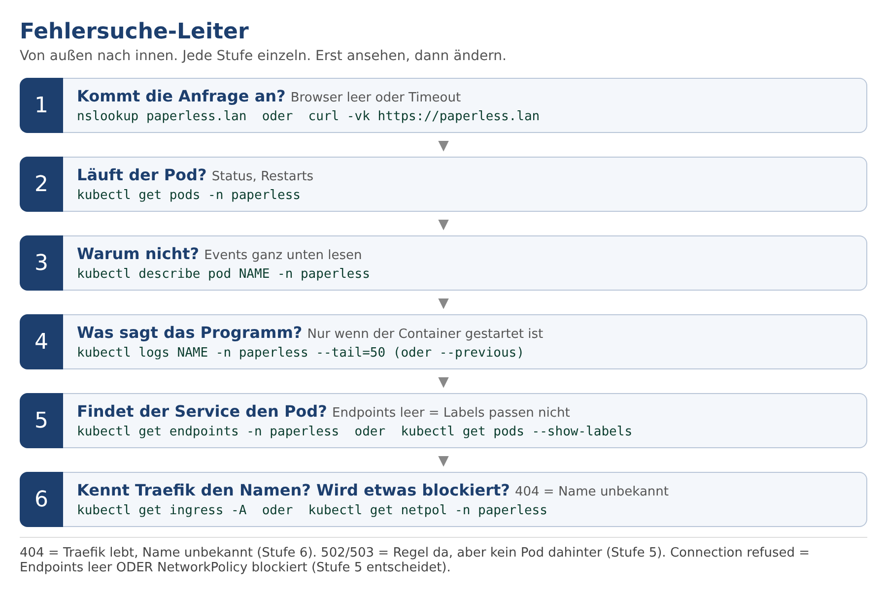
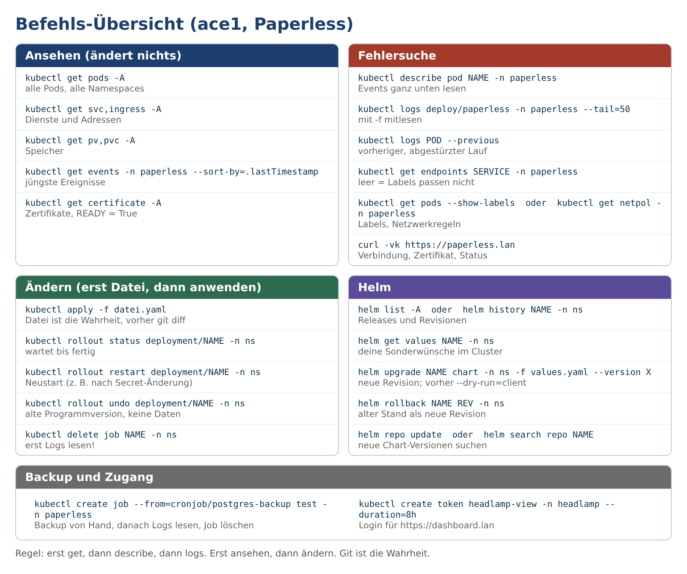

# Paperless-ngx auf k3s: Zusammenfassung und Anleitung

Stand: 03.11.2026. Diese Anleitung fasst das fertige Projekt zusammen: was wir gebaut haben, in welcher Reihenfolge und mit welchen Befehlen. Die vollständigen Manifeste liegen im Git-Repository `ace1-kubernetes` (siehe `README.md`).

## 1. Ziel und Ergebnis

Auf einem kleinen Rechner läuft Paperless-ngx in einem k3s-Cluster. Es ist per HTTPS im LAN erreichbar (`https://paperless.lan`, eigene IP, Port 443). Die Dokumente liegen auf dem NAS, ein Brother-Scanner legt Scans direkt in den Eingangsordner, ein täglicher Datenbank-Dump sichert die Metadaten, und Netzwerkregeln schützen Datenbank und Cache.

| Baustein | Umsetzung |
|---|---|
| Server | "ace1": Intel N100, 16 GB RAM, 512 GB SSD, Debian 13 (Trixie), ohne Desktop, ohne Festplattenverschlüsselung |
| Kubernetes | k3s (Single Node), Traefik und ServiceLB abgeschaltet |
| LoadBalancer | MetalLB (Layer 2), Bereich 192.168.88.240 bis .250 |
| Reverse Proxy | Traefik per Helm, feste IP 192.168.88.240, HTTP wird auf HTTPS umgeleitet |
| TLS | cert-manager mit eigener CA ("homelab-ca") |
| Speicher | Dokumente auf dem NAS (NFSv3), Datenbank auf der SSD (`local-path`) |
| Anwendung | Paperless-ngx 3.3.4, PostgreSQL 17, Redis 7 |
| Scanner | Brother ADS-1800W, SMB direkt in den Ordner `consume` |
| Backup | täglicher `pg_dump` per CronJob auf das NAS, 14 Tage Aufbewahrung |
| Härtung | SSH nur mit Key, ufw, k3s Secrets-Verschlüsselung, NetworkPolicies |
| Web-GUI | Headlamp unter `https://dashboard.lan`, Token-Login (ansehen oder ändern), nur LAN |

Adressen im LAN (192.168.88.0/24):

| Name | Adresse |
|---|---|
| ace1.lan | 192.168.88.27 (DHCP-Reservierung am MikroTik) |
| ugreen.lan (NAS) | 192.168.88.106 |
| scanner.lan | 192.168.88.17 |
| paperless.lan | 192.168.88.240 (statischer DNS-Eintrag am MikroTik) |
| dashboard.lan | 192.168.88.240 (CNAME auf paperless.lan) |

Alle `kubectl`- und `helm`-Befehle laufen auf dem Mac. Befehle für den Server stehen ausdrücklich bei "auf ace1".

## 2. Router vorbereiten (MikroTik)

1. Für ace1 und den Scanner eine DHCP-Reservierung (Address Reservation) anlegen.
2. MetalLB-Bereich 192.168.88.240 bis .250 aus dem DHCP-Pool nehmen. Pool und Namen mit `/ip pool print` prüfen, dann den Pool so kürzen, dass dieser Bereich fehlt:
   ```
   /ip pool set default-dhcp ranges=192.168.88.10-192.168.88.239,192.168.88.251-192.168.88.254
   ```
3. DNS-Eintrag für den Dienst:
   ```
   /ip dns static add name=paperless.lan address=192.168.88.240
   ```
4. Für die Web-GUI (Abschnitt 15) ein zweiter Name auf dieselbe IP, hier als CNAME:
   ```
   /ip dns static add name=dashboard.lan type=CNAME cname=paperless.lan
   ```
   Alternativ ein A-Eintrag mit `address=192.168.88.240`. Beide Namen landen bei Traefik, der sie über den Host-Namen unterscheidet.

## 3. Server: Debian installieren und absichern (auf ace1)

**Installation:** Debian 13 Server, ein Root-Dateisystem (ext4) plus EFI, kein Swap, keine LVM- und keine LUKS-Verschlüsselung. Hostname `ace1`, Netzwerk per DHCP. Bei der Softwareauswahl nur "SSH server" und die Standard-Systemwerkzeuge.

**SSH-Key (auf dem Mac):**
```bash
ssh-keygen -t ed25519 -C "toni@mac"
ssh-copy-id toni@ace1.lan
ssh toni@ace1.lan        # Test ohne Passwort
```

**SSH härten (auf ace1):** Datei `/etc/ssh/sshd_config.d/10-hardening.conf` mit
```
PasswordAuthentication no
KbdInteractiveAuthentication no
PermitRootLogin no
AllowUsers toni
```
```bash
sudo sshd -t
sudo systemctl reload ssh
```
Vor dem Abmelden in einem zweiten Terminal prüfen, dass der Key-Login klappt.

**Automatische Sicherheitsupdates (auf ace1):**
```bash
sudo apt update
sudo apt install unattended-upgrades apt-listchanges
sudo dpkg-reconfigure -plow unattended-upgrades
sudo unattended-upgrade --dry-run --debug
```
Optional in `/etc/apt/apt.conf.d/50unattended-upgrades` den automatischen Neustart um 04:00 Uhr aktivieren (`Automatic-Reboot "true"`, `Automatic-Reboot-Time "04:00"`).

**Swap prüfen (auf ace1):** Kubernetes erwartet keinen Swap.
```bash
free -h                  # Swap muss 0B zeigen
grep swap /etc/fstab     # darf keine aktive Zeile liefern
```

**Firewall (auf ace1):** Der Port 6443 (Kubernetes-API) ist für das ganze LAN freigegeben, damit jedes Notebook im Heimnetz mit `kubectl` zugreifen kann, sobald es eine Kubeconfig hat. Wer den Zugang auf einen Rechner beschränken will, setzt dessen feste IP (Reservierung) statt des Netzes ein. Getestet am 03.11.2026 vom Mac aus (`nc -vz`): Die Ports 6443 und 22 antworten, `ufw status` zeigt für beide eine Regel für `192.168.88.0/24`. Die anderen Notebooks wurden nicht selbst getestet.
```bash
sudo apt install ufw
sudo ufw default deny incoming
sudo ufw default allow outgoing
sudo ufw allow from 192.168.88.0/24 to any port 22 proto tcp
sudo ufw allow from 192.168.88.0/24 to any port 6443 proto tcp
sudo ufw allow from 10.42.0.0/16 to any
sudo ufw allow from 10.43.0.0/16 to any
sudo ufw allow from 192.168.88.0/24 to any port 80 proto tcp
sudo ufw allow from 192.168.88.0/24 to any port 443 proto tcp
sudo ufw enable
sudo ufw status verbose
```
Die Regeln für 10.42.0.0/16 und 10.43.0.0/16 erlauben den internen Cluster-Verkehr (Pods und Services). Danach einen Neustart testen (SSH erreichbar, kein Swap, ufw aktiv).

Wichtig: `ufw enable` muss wirklich ausgeführt werden. Eine eingerichtete, aber nicht eingeschaltete Firewall (`ufw status` zeigt `inactive`) schützt nichts. Das war im Projekt vom 25.10. bis 03.11.2026 der Fall und fiel erst bei der Prüfung auf. Seit dem 03.11.2026 ist die Firewall aktiv, nach einem Neustart geprüft (`ufw status` active, `kubectl get nodes` Ready, `paperless.lan` HTTP/2 302, `dashboard.lan` HTTP/2 200). Beim Einschalten kann ein Zeitgeber als Notausgang helfen: `sudo systemd-run --on-active=5m --unit=ufw-notaus ufw disable`. Er schaltet die Firewall nach fünf Minuten wirklich wieder aus, die Tests müssen also vorher fertig sein. Der Zugang von weiteren Notebooks im LAN wurde nicht getestet.

## 4. k3s installieren (auf ace1)

Konfigurationsdatei anlegen:
```bash
sudo mkdir -p /etc/rancher/k3s
sudoedit /etc/rancher/k3s/config.yaml
```
Inhalt:
```yaml
write-kubeconfig-mode: "0600"
disable:
  - traefik
  - servicelb
tls-san:
  - ace1.lan
  - 192.168.88.27
secrets-encryption: true
```
Installation:
```bash
sudo apt install curl
curl -sfL https://get.k3s.io -o k3s-install.sh
less k3s-install.sh              # Skript vor dem Ausführen ansehen
sudo sh k3s-install.sh
sudo k3s kubectl get nodes       # Node muss Ready sein
sudo k3s kubectl get pods -A
```
Die Version des Installers gibt `k3s --version` aus, bitte in `REQUIREMENTS.md` eintragen.

## 5. Arbeitsplatz einrichten (auf dem Mac)

```bash
brew install kubernetes-cli kubectx helm
```

Kubeconfig holen (erst auf ace1 eine Kopie für den Benutzer anlegen, danach löschen):
```bash
# auf ace1
sudo cp /etc/rancher/k3s/k3s.yaml ~/k3s.yaml
sudo chown toni: ~/k3s.yaml

# auf dem Mac
mkdir -p ~/.kube/configs && chmod 700 ~/.kube ~/.kube/configs
scp toni@ace1.lan:k3s.yaml ~/.kube/configs/ace1.yaml
chmod 600 ~/.kube/configs/ace1.yaml
sed -i '' -e 's#https://127.0.0.1:6443#https://ace1.lan:6443#' -e 's#: default$#: ace1#' ~/.kube/configs/ace1.yaml

# auf ace1
rm ~/k3s.yaml
```
In `~/.bash_profile` (bash als Login-Shell unter macOS; bei zsh stattdessen `~/.zshrc`):
```bash
export KUBECONFIG=$(ls ~/.kube/configs/*.yaml 2>/dev/null | tr '\n' ':')
```
Neue Shell öffnen, dann `kubectl config get-contexts` und `kubectl get nodes`. Weitere Cluster sind einfach zusätzliche Dateien in `~/.kube/configs/`; gewechselt wird mit `kubectx <name>`.

Die Kubeconfig enthält Admin-Rechte: nie ins Git, nie in Cloud-Ordner.

## 6. MetalLB

```bash
helm repo add metallb https://metallb.github.io/metallb
helm repo update
kubectl create namespace metallb-system
kubectl label namespace metallb-system pod-security.kubernetes.io/enforce=privileged
helm install metallb metallb/metallb -n metallb-system
kubectl get pods -n metallb-system      # controller, speaker, frr-k8s: Running
```
Datei `metallb-config.yaml`:
```yaml
apiVersion: metallb.io/v1beta1
kind: IPAddressPool
metadata:
  name: lan-pool
  namespace: metallb-system
spec:
  addresses:
    - 192.168.88.240-192.168.88.250
---
apiVersion: metallb.io/v1beta1
kind: L2Advertisement
metadata:
  name: lan-l2
  namespace: metallb-system
spec:
  ipAddressPools:
    - lan-pool
```
```bash
kubectl apply -f metallb-config.yaml
kubectl get ipaddresspools,l2advertisements -n metallb-system
```

## 7. Traefik (Reverse Proxy)

Datei `traefik-values.yaml`:
```yaml
service:
  annotations:
    metallb.io/loadBalancerIPs: 192.168.88.240
ports:
  web:
    http:
      redirections:
        entryPoint:
          to: websecure
          scheme: https
```
```bash
helm repo add traefik https://traefik.github.io/charts
helm repo update
helm install traefik traefik/traefik -n traefik --create-namespace -f traefik-values.yaml
kubectl get pods,svc -n traefik          # EXTERNAL-IP 192.168.88.240
curl -k https://192.168.88.240           # Erwartet: 404 page not found
curl -I http://192.168.88.240            # Erwartet: 308 Redirect auf https
```
Die 404-Antwort ist richtig: Traefik läuft, kennt aber noch keine Anwendung.

## 8. cert-manager und eigene CA

```bash
helm repo add jetstack https://charts.jetstack.io
helm repo update
helm install cert-manager jetstack/cert-manager -n cert-manager --create-namespace --set crds.enabled=true
kubectl get pods -n cert-manager         # drei Pods Running
```
Datei `ca.yaml` (selbstsignierter Issuer, CA-Zertifikat, CA-Issuer):
```yaml
apiVersion: cert-manager.io/v1
kind: ClusterIssuer
metadata:
  name: selfsigned
spec:
  selfSigned: {}
---
apiVersion: cert-manager.io/v1
kind: Certificate
metadata:
  name: homelab-ca
  namespace: cert-manager
spec:
  isCA: true
  commonName: homelab-ca
  secretName: homelab-ca-secret
  duration: 87600h
  privateKey:
    algorithm: ECDSA
    size: 256
  issuerRef:
    name: selfsigned
    kind: ClusterIssuer
---
apiVersion: cert-manager.io/v1
kind: ClusterIssuer
metadata:
  name: homelab-ca
spec:
  ca:
    secretName: homelab-ca-secret
```
```bash
kubectl apply -f ca.yaml
kubectl get clusterissuer                # beide READY True
```
**CA auf den Geräten als vertrauenswürdig eintragen:**

Zu importieren ist die **CA** (`homelab-ca`), nicht die Zertifikate der einzelnen Dienste. Danach sind `paperless.lan`, `dashboard.lan` und alles, was die CA künftig unterschreibt, vertraut. Die Dienstzertifikate erneuert cert-manager selbst. Die Dienstzertifikate sind nicht selbstsigniert, nur die CA ist es.

**1. Datei holen** (nur der öffentliche Teil, in einen Ordner außerhalb des Repositories):
```bash
mkdir -p ~/browser-zertifikat && cd ~/browser-zertifikat
kubectl get secret homelab-ca-secret -n cert-manager -o jsonpath='{.data.ca\.crt}' | base64 -d > homelab-ca.crt
openssl x509 -in homelab-ca.crt -noout -subject -issuer -dates    # subject und issuer gleich, Laufzeit notieren
```

**2. Eintragen:**
- **Safari und Chrome (macOS)** nutzen den Schlüsselbund:
  ```bash
  sudo security add-trusted-cert -d -r trustRoot -k /Library/Keychains/System.keychain homelab-ca.crt
  ```
  Danach den Browser mit Cmd+Q komplett beenden und neu starten. Alternativ per Doppelklick auf die Datei, in der Schlüsselbundverwaltung unter "System" den Eintrag öffnen und bei "Vertrauen" auf "Immer vertrauen" stellen.
- **Firefox** hat einen eigenen Speicher: Einstellungen, Datenschutz und Sicherheit, "Zertifikate anzeigen", Reiter "Zertifizierungsstellen", "Importieren", Datei wählen, "Dieser CA vertrauen, um Websites zu identifizieren" anhaken.
- **Handy und Tablet:** Die Datei als CA-Zertifikat installieren. Der Import gilt immer nur für das jeweilige Gerät.

**3. Prüfen** (der Reihe nach, wenn der Browser trotzdem warnt):
```bash
# a) Welches Zertifikat liefert der Server? Der issuer muss homelab-ca sein (nicht "TRAEFIK DEFAULT CERT").
#    Ein leeres subject ist normal, der Name steht im Feld "Subject Alternative Name".
echo | openssl s_client -connect 192.168.88.240:443 -servername dashboard.lan 2>/dev/null | openssl x509 -noout -subject -issuer -dates
# b) Passt die Datei zum Zertifikat? Erwartet: OK
kubectl get secret headlamp-tls -n headlamp -o jsonpath='{.data.tls\.crt}' | base64 -d > leaf.pem
openssl verify -CAfile homelab-ca.crt leaf.pem; rm leaf.pem
# c) Vertraut macOS der CA? Erwartet: HTTP/2 200 (der Systembefehl nutzt den Schlüsselbund)
/usr/bin/curl -sI https://dashboard.lan | head -1
```
Sind a) bis c) in Ordnung und der Browser warnt trotzdem, liegt es am Browser. Bei uns war es der alte Zustand im normalen Profil von Chrome: Im privaten Fenster (Cmd+Shift+N) war alles fehlerfrei. Dann Chrome mit Cmd+Q beenden (`pgrep -x "Google Chrome" || echo beendet`), `https://dashboard.lan` mit Schema eintippen (bei `http://` zeigt Chrome immer "Nicht sicher") und den Cache leeren. Den genauen Fehlercode (`NET::ERR_...`) verrät der Fehlerbildschirm: `AUTHORITY_INVALID` heißt CA unbekannt, `COMMON_NAME_INVALID` falscher Name (zum Beispiel Zugriff über die IP), `DATE_INVALID` Datum.

Nur `homelab-ca.crt` (öffentlich) weitergeben, nie den privaten Schlüssel der CA. Die Datei steht in der `.gitignore`.

## 9. NAS vorbereiten (UGREEN DXP2800)

1. Gemeinsamen Ordner `paperless` mit den Unterordnern `consume`, `media` und `backup` anlegen.
2. NFS aktivieren. Regel für `paperless`: Server-Adresse **192.168.88.27** (nur ace1), Lesen/Schreiben, Squash "Keine Zuordnung", Sicherheit Auth_Sys, **Asynchron aus**, "Verbindung von nicht privilegierten Ports" aus.
3. SMB aktivieren, Benutzer `scanner` mit starkem Passwort anlegen, Schreibrecht nur auf `consume`.

**Test auf ace1:**
```bash
sudo apt install nfs-common
sudo /usr/sbin/showmount -e ugreen.lan   # liegt in /usr/sbin, das steht nicht im PATH von toni
sudo mkdir -p /mnt/test
sudo mount -t nfs -o nfsvers=3 ugreen.lan:/volume1/paperless/media /mnt/test
ls -la /mnt/test
sudo umount /mnt/test
```
Wichtig: Die Unterordner funktionieren mit NFS Version 3. Den Test immer mit genau dem Pfad und den Optionen ausführen, die später im PersistentVolume stehen.

## 10. Paperless: Namespace, Speicher, Datenbank, Cache

Ordner im Repository: `ace1-kubernetes/paperless/`. Dateien werden mit `cat > datei <<'EOF' ... EOF` angelegt und mit `kubectl apply -f` angewendet.

**`00-namespace.yaml`:** Namespace `paperless` mit Label `pod-security.kubernetes.io/enforce: baseline`.

**`10-storage-nfs.yaml`:** je ein PersistentVolume und ein Claim für `media` (200 Gi) und `consume` (10 Gi). Wichtige Einstellungen: `accessModes: ReadWriteMany`, `persistentVolumeReclaimPolicy: Retain`, `storageClassName: nfs-nas`, `mountOptions: [nfsvers=3, hard]`, NFS-Server `192.168.88.106` mit den Pfaden `/volume1/paperless/media` und `/volume1/paperless/consume`. Der Claim bindet das Volume über `volumeName`.

**Secrets (direkt im Cluster, nicht im Git):**
```bash
kubectl create secret generic postgres-secret -n paperless \
  --from-literal=POSTGRES_PASSWORD="$(openssl rand -base64 24 | tr -d '/+=')"

kubectl create secret generic paperless-secret -n paperless \
  --from-literal=PAPERLESS_SECRET_KEY="$(openssl rand -base64 48 | tr -d '/+=')" \
  --from-literal=PAPERLESS_ADMIN_USER="admin" \
  --from-literal=PAPERLESS_ADMIN_PASSWORD="<eigenes-passwort>"
```

**`20-postgres.yaml`:** StatefulSet `postgres` (Image `postgres:17-alpine`), Datenbank und Benutzer `paperless`, Passwort aus `postgres-secret`, `PGDATA=/var/lib/postgresql/data/pgdata`, `volumeClaimTemplates` mit `local-path` (10 Gi), `readinessProbe` mit `pg_isready`, Ressourcen (Request 100m CPU und 256 Mi, Limit 1 Gi). Dazu ein Service `postgres` auf Port 5432.

**`30-redis.yaml`:** Deployment `redis` (`redis:7-alpine`) ohne Persistenz (`--save "" --appendonly no`), Service `redis` auf Port 6379.

```bash
kubectl apply -f 00-namespace.yaml
kubectl apply -f 10-storage-nfs.yaml
kubectl apply -f 20-postgres.yaml
kubectl apply -f 30-redis.yaml
kubectl get pv
kubectl get pvc,pods -n paperless        # PV/PVC Bound, Pods Running
```

## 11. Paperless-ngx deployen

**`40-paperless.yaml`** enthält einen Claim `paperless-data` (5 Gi, `local-path`), das Deployment und den Service `paperless` (Port 8000). Wichtige Punkte im Deployment:

- Image fest gepinnt: `ghcr.io/paperless-ngx/paperless-ngx:3.3.4`
- `replicas: 1`, `strategy: Recreate`
- Im Pod-Template **`enableServiceLinks: false`** (verhindert, dass Kubernetes aus dem Servicenamen Variablen wie `PAPERLESS_PORT` erzeugt, die die Konfiguration stören)
- Umgebungsvariablen:

| Variable | Wert |
|---|---|
| `PAPERLESS_REDIS` | `redis://redis:6379` |
| `PAPERLESS_DBHOST`, `_DBNAME`, `_DBUSER` | `postgres`, `paperless`, `paperless` |
| `PAPERLESS_DBPASS` | aus `postgres-secret` |
| `PAPERLESS_SECRET_KEY`, `_ADMIN_USER`, `_ADMIN_PASSWORD` | aus `paperless-secret` |
| `PAPERLESS_URL` | `https://paperless.lan` |
| `PAPERLESS_OCR_LANGUAGE` | `deu+eng` |
| `PAPERLESS_OCR_LANGUAGES` | `eng` |
| `PAPERLESS_TIME_ZONE` | `Europe/Berlin` |
| `PAPERLESS_CONSUMER_POLLING_INTERVAL` | `"60"` |

- Volumes: `data` (lokal) nach `/usr/src/paperless/data`, `media` und `consume` (NFS) nach `/usr/src/paperless/media` und `/usr/src/paperless/consume`
- `readinessProbe` auf Port 8000, Ressourcen (Request 250m CPU und 1 Gi, Limit 3 Gi)

```bash
kubectl apply -f 40-paperless.yaml
kubectl get pods -n paperless -w
kubectl logs deploy/paperless -n paperless --tail=30
```
Der erste Start dauert einige Minuten (Datenbank-Migration, Sprachpaket).

**`50-ingress.yaml`:**
```yaml
apiVersion: networking.k8s.io/v1
kind: Ingress
metadata:
  name: paperless
  namespace: paperless
  annotations:
    cert-manager.io/cluster-issuer: homelab-ca
    traefik.ingress.kubernetes.io/router.entrypoints: websecure
spec:
  ingressClassName: traefik
  tls:
    - hosts:
        - paperless.lan
      secretName: paperless-tls
  rules:
    - host: paperless.lan
      http:
        paths:
          - path: /
            pathType: Prefix
            backend:
              service:
                name: paperless
                port:
                  number: 8000
```
```bash
kubectl apply -f 50-ingress.yaml
kubectl get ingress,certificate -n paperless     # Certificate READY True
```
Danach `https://paperless.lan` im Browser öffnen und mit dem Admin-Benutzer aus dem Secret anmelden. Die Annotation `cert-manager.io/cluster-issuer` bewirkt, dass cert-manager das Zertifikat selbst bestellt und erneuert.

## 12. Scanner (Brother ADS-1800W)

Im Web-Interface des Scanners (`http://192.168.88.17`) ein Profil für "Scan to Network" anlegen:

| Feld | Wert |
|---|---|
| Netzwerkordnerpfad | `\\192.168.88.106\paperless\consume` |
| Benutzername / Kennwort | `scanner` / NAS-Passwort |
| Dateityp | PDF (mehrseitig) |
| Qualität | Grau 150 dpi (bewusst gewählt: mehrseitige PDFs werden bei höherer Auflösung zu groß für den Mailversand) |
| Leere Seiten überspringen | an (laut Anleitung, nicht per Screenshot bestätigt) |

Den Testknopf im Web-Interface nutzen, dann einen echten Scan am Gerät auslösen. Auf ace1 lässt sich die Ankunft beobachten:
```bash
sudo mount -t nfs -o nfsvers=3 ugreen.lan:/volume1/paperless /mnt/test
watch -n 2 ls -la /mnt/test/consume
```
Innerhalb von rund 60 Sekunden verschwindet die Datei, und das Dokument erscheint in Paperless. Datum und Uhrzeit des Scanners sollten im Web-Interface korrekt eingestellt werden.

## 13. Backup und Restore

**`60-backup.yaml`:** PersistentVolume und Claim `paperless-backup` (NFS, `nfsvers=3`, Pfad `/volume1/paperless/backup`) und ein CronJob `postgres-backup`:

- Zeitplan `0 3 * * *`, `timeZone: Europe/Berlin`, `concurrencyPolicy: Forbid`
- Im Job-Template ein Label `app: postgres-backup` (wird von den NetworkPolicies gebraucht)
- Pod-Einstellungen: `enableServiceLinks: false`, läuft als root (`runAsUser: 0`), Container mit `allowPrivilegeEscalation: false` und `capabilities: drop: ["ALL"]`
- Image `postgres:17-alpine`, Passwort per `PGPASSWORD` aus `postgres-secret`
- Befehl:
  ```sh
  set -e
  F=/backup/paperless-$(date +%Y%m%d-%H%M%S).dump
  echo "Start $(date -u)"
  i=0
  until pg_dump -h postgres -U paperless -Fc paperless > "$F.tmp" 2> /tmp/err; do
    i=$((i+1))
    echo "Versuch $i fehlgeschlagen:"
    cat /tmp/err
    rm -f "$F.tmp"
    if [ "$i" -ge 5 ]; then exit 1; fi
    sleep 5
  done
  mv "$F.tmp" "$F"
  find /backup -name 'paperless-*.dump' -mtime +14 -delete
  find /backup -name 'paperless-*.dump.tmp' -mmin +60 -delete
  ls -lh /backup
  ```
  Der Dump wird zuerst in eine `.tmp`-Datei geschrieben und erst nach Erfolg umbenannt. Das Skript wiederholt `pg_dump` bis zu fünfmal und gibt jeden Fehler aus (Begründung siehe Kasten unten).

**Von Hand auslösen und prüfen:**
```bash
kubectl apply -f 60-backup.yaml
kubectl create job --from=cronjob/postgres-backup test-backup -n paperless
sleep 25
kubectl logs -n paperless -l job-name=test-backup --tail=-1
kubectl delete job test-backup -n paperless
```
Mit einem Label-Selektor (`-l`) zeigt `kubectl logs` ohne `--tail=-1` nur die letzten 10 Zeilen. Den Job erst löschen, nachdem du den Log gelesen hast, denn mit dem Job verschwindet auch der Pod samt Log.

**Bekannte Eigenheit: der erste Versuch scheitert fast immer.** Ein frisch gestarteter Backup-Pod erreicht Postgres in der ersten Sekunde noch nicht. Im Log steht dann `Versuch 1 fehlgeschlagen:` und `pg_dump: error: connection to server at "postgres" ..., port 5432 failed: Connection refused`, der zweite Versuch gelingt. Gemessen mit einem Wegwerf-Pod (Label `app=postgres-backup`, `pg_isready` im Sekundentakt): erste Sekunde `no response`, danach durchgehend `accepting connections`. Der Fehler trat erstmals nach dem Anlegen der NetworkPolicies auf (25.10.2026, 15:57 UTC) und ohne sie nicht (Dump um 15:11). Wahrscheinliche Erklärung, nicht bewiesen: Die Regeln arbeiten mit Label-Listen, und ein neuer Pod steht erst nach kurzer Zeit darin. Deshalb wiederholt das Skript den Versuch. Das ist ein Gegenmittel und keine Behebung der Ursache.

**Restore-Test (immer in eine leere Datenbank):**
```bash
kubectl exec -n paperless postgres-0 -- psql -U paperless -d postgres -c "CREATE DATABASE restoretest;"
kubectl run restore-test -n paperless --rm -it --restart=Never --labels=app=postgres-backup \
  --image=postgres:17-alpine \
  --overrides='{"spec":{"enableServiceLinks":false,"containers":[{"name":"restore-test","image":"postgres:17-alpine","stdin":true,"tty":true,"command":["sh"],"env":[{"name":"PGPASSWORD","valueFrom":{"secretKeyRef":{"name":"postgres-secret","key":"POSTGRES_PASSWORD"}}}],"volumeMounts":[{"name":"b","mountPath":"/backup"}]}],"volumes":[{"name":"b","persistentVolumeClaim":{"claimName":"paperless-backup"}}]}}'
```
In der Shell des Test-Pods:
```sh
ls /backup
pg_restore -h postgres -U paperless -d restoretest --no-owner /backup/<dateiname>.dump 2>&1 | tail -n 15
psql -h postgres -U paperless -d restoretest -c "select count(*) from documents_document;"
exit
```
Keine Fehlerzeilen und eine Dokumentzahl wie in der echten Datenbank bedeuten: Das Backup funktioniert. Danach aufräumen:
```bash
kubectl exec -n paperless postgres-0 -- psql -U paperless -d postgres -c "DROP DATABASE restoretest;"
```
Das Label `app=postgres-backup` am Restore-Pod ist nötig, weil die NetworkPolicies sonst den Zugriff auf Postgres blockieren.

**Secrets und CA sichern** (außerhalb des Git-Repositories, danach auf einen zweiten Datenträger kopieren):
```bash
mkdir -p ~/secrets-backup && chmod 700 ~/secrets-backup && cd ~/secrets-backup
kubectl get secret postgres-secret paperless-secret -n paperless -o yaml > paperless-secrets.yaml
kubectl get secret homelab-ca-secret -n cert-manager -o yaml > homelab-ca-secret.yaml
chmod 600 *.yaml
```
Die Dateien sind nur base64-kodiert, nicht verschlüsselt. Das ist hier eine bewusste Entscheidung für das Heimnetz.

**Hinweis:** RAID 1 im NAS ist kein Backup. Es schützt vor dem Ausfall einer Platte, nicht vor Löschen, Ransomware oder Totalausfall. Allgemein empfohlen ist eine zusätzliche Sicherung auf eine externe Platte oder in die Cloud. In diesem Projekt verzichten wir bewusst darauf (Entscheidung vom 03.11.2026).

## 14. Netzwerkregeln (NetworkPolicies)

**`70-networkpolicies.yaml`** enthält vier Regeln im Namespace `paperless` (nur eingehender Verkehr):

1. `default-deny-ingress`: alles eingehende ist verboten.
2. Postgres darf nur von Pods mit `app: paperless` und `app: postgres-backup` auf Port 5432 erreicht werden.
3. Redis darf nur von `app: paperless` auf Port 6379 erreicht werden.
4. Paperless darf nur von Traefik (Namespace `traefik`, Label `app.kubernetes.io/name: traefik`) auf Port 8000 erreicht werden.

```bash
kubectl apply -f 70-networkpolicies.yaml
kubectl get networkpolicy -n paperless          # vier Regeln
```
**Prüfen (Sperre beweisen):**
```bash
# ohne passendes Label: Timeout erwartet
kubectl run nettest -n paperless --rm -it --restart=Never --image=busybox -- nc -zv -w 3 postgres 5432
# mit Label: "open" erwartet
kubectl run nettest -n paperless --rm -it --restart=Never --labels=app=paperless --image=busybox -- nc -zv -w 3 postgres 5432
```
Danach `https://paperless.lan` neu laden und einen Backup-Lauf testen. Notbremse: `kubectl delete -f 70-networkpolicies.yaml`. Ausgehender Verkehr ist nicht eingeschränkt.

## 15. Web-GUI (Headlamp)

Zum Lernen gibt es eine Web-Oberfläche, die dasselbe zeigt wie die Terminalbefehle (Pods, Deployments, Services, Labels). Der Kurs selbst bleibt im Terminal. Das klassische Kubernetes Dashboard ist archiviert, das Kubernetes-Projekt empfiehlt Headlamp als Nachfolger.

**Ergebnis:** `https://dashboard.lan` über denselben Traefik wie Paperless (Zertifikat der eigenen CA), Anmeldung mit Token. Zwei Zugänge:

| Zugang | Rechte | Verwendung |
|---|---|---|
| `headlamp-view` | nur ansehen (ohne Secrets), zusätzlich Knoten, Namespaces, Volumes | Normalfall, zum Lernen |
| `headlamp-admin` | `cluster-admin` | nur bewusst und kurz, zum Ändern |

Die Tokens liegen nicht im Cluster. Sie werden bei Bedarf erzeugt und laufen ab.

**Dateien** im Ordner `ace1-kubernetes/headlamp/`:

- `00-namespace.yaml`: Namespace `headlamp` mit Pod-Security `baseline`
- `10-rbac.yaml`: zwei Dienstkonten, das ClusterRole `headlamp-cluster-read` und die ClusterRoleBindings (`view` plus `headlamp-cluster-read` für den Lesezugang, `cluster-admin` für den Admin-Zugang)
- `headlamp-values.yaml`: Helm-Values
- `20-networkpolicy.yaml`: Netzwerkregeln, nur Traefik darf Headlamp erreichen

`headlamp-values.yaml`:
```yaml
# Helm-Values für Headlamp (Web-GUI), erreichbar unter https://dashboard.lan
ingress:
  enabled: true
  ingressClassName: traefik
  annotations:
    cert-manager.io/cluster-issuer: homelab-ca
    traefik.ingress.kubernetes.io/router.entrypoints: websecure
  hosts:
    - host: dashboard.lan
      paths:
        - path: /
          type: Prefix
  tls:
    - secretName: headlamp-tls
      hosts:
        - dashboard.lan
service:
  type: ClusterIP
config:
  sessionTTL: 3600
clusterRoleBinding:
  create: false
```

**Wichtig:** Der Chart legt standardmäßig ein ClusterRoleBinding an, das das Dienstkonto des Headlamp-Pods mit `cluster-admin` verbindet. Das ist mit `clusterRoleBinding.create: false` abgeschaltet. Was ein Chart anlegt, zeigt vor der Installation `helm template`, und ob die Optionen in der gewählten Version existieren, zeigt `helm show values`.

**Installation (auf dem Mac, im Ordner `ace1-kubernetes/headlamp`):**
```bash
helm repo add headlamp https://kubernetes-sigs.github.io/headlamp/
helm repo update
helm search repo headlamp/headlamp                  # Version notieren, hier 0.46.0
helm template headlamp headlamp/headlamp -n headlamp -f headlamp-values.yaml --version 0.46.0 | grep -E "^kind:|^  name:|ClusterRoleBinding"
kubectl apply -f 00-namespace.yaml
kubectl apply -f 10-rbac.yaml
helm install headlamp headlamp/headlamp -n headlamp -f headlamp-values.yaml --version 0.46.0
kubectl get pods,svc,ingress,certificate -n headlamp   # Pod Running, Certificate READY True
```
In der Vorschau darf kein `ClusterRoleBinding` erscheinen.

**Token erzeugen (auf dem Mac):**

Beide Tokens entstehen mit `kubectl create token`, ohne Passwort und ohne Secret. Das Dienstkonto bestimmt die Rechte, `--duration` die Laufzeit.

```bash
# Lese-Token (Normalfall, 8 Stunden), direkt in die Zwischenablage:
kubectl create token headlamp-view -n headlamp --duration=8h | pbcopy

# Admin-Token (nur zum bewussten Ändern, 1 Stunde):
kubectl create token headlamp-admin -n headlamp --duration=1h | pbcopy
```

Ohne `| pbcopy` erscheint das Token im Terminal (lange Zeichenkette, beginnt mit `eyJ`). Mit `pbcopy` fügst du es mit Cmd+V in die Anmeldemaske von `https://dashboard.lan` ein und es landet nicht im Terminal-Verlauf. `-n headlamp` ist der Namespace der Dienstkonten, nicht der, den du in der GUI ansiehst. Nach Ablauf wirft die GUI dich raus, dann erzeugst du ein neues Token. Einzelne Tokens lassen sich nicht widerrufen. Im Notfall löschst du das Dienstkonto (`kubectl delete sa headlamp-admin -n headlamp`) und legst es mit `kubectl apply -f 10-rbac.yaml` neu an.

**Token nie in Git, Chats oder Notizen ablegen.** Mit dem Admin-Token kannst du alles löschen, auch Paperless.

**Rechte der beiden Konten testen** (ohne Token, über die Identität des Dienstkontos):
```bash
# Admin: erwartet yes
kubectl auth can-i delete pods -n paperless --as=system:serviceaccount:headlamp:headlamp-admin
# Lesen: erwartet no
kubectl auth can-i delete pods -n paperless --as=system:serviceaccount:headlamp:headlamp-view
# Lesen: erwartet yes
kubectl auth can-i list pods -n paperless --as=system:serviceaccount:headlamp:headlamp-view
```
Mit `--as=system:serviceaccount:<namespace>:<name>` fragst du, was dieses Konto dürfte. Das funktioniert, weil dein eigener Zugang Admin ist und andere Identitäten nachbilden darf.

In der GUI scheitert ein Löschversuch mit dem Lese-Token mit `forbidden`.

**Browser:** Die CA wird nach Abschnitt 8 eingetragen (Safari und Chrome über den Schlüsselbund, Firefox in seinem eigenen Speicher). Meldet der Browser trotzdem Probleme, helfen dort die drei Prüfungen.

**Netzwerkregeln (`20-networkpolicy.yaml`):** Im Namespace `headlamp` darf nur Traefik die GUI erreichen. Zwei Regeln in einer Datei:

```yaml
apiVersion: networking.k8s.io/v1
kind: NetworkPolicy
metadata:
  name: default-deny-ingress
  namespace: headlamp
spec:
  podSelector: {}
  policyTypes:
    - Ingress
---
apiVersion: networking.k8s.io/v1
kind: NetworkPolicy
metadata:
  name: allow-headlamp-from-traefik
  namespace: headlamp
spec:
  podSelector:
    matchLabels:
      app.kubernetes.io/name: headlamp
  policyTypes:
    - Ingress
  ingress:
    - from:
        - namespaceSelector:
            matchLabels:
              kubernetes.io/metadata.name: traefik
          podSelector:
            matchLabels:
              app.kubernetes.io/name: traefik
      ports:
        - protocol: TCP
          port: 4466
```
Die erste Regel sperrt alles Eingehende im Namespace, die zweite lässt nur Traefik durch. Die Werte stammen aus dem System: Pod-Port aus `Endpoints` von `kubectl describe service headlamp -n headlamp` (4466, der Service selbst hat Port 80), Labels aus `kubectl get pods -n headlamp --show-labels` und `kubectl get pods -n traefik --show-labels`, Namespace-Label aus `kubectl get namespace traefik --show-labels`. `namespaceSelector` und `podSelector` stehen in **einem** Listeneintrag (UND), mit zwei Einträgen würde es ODER heißen.

```bash
kubectl apply --dry-run=server -f headlamp/20-networkpolicy.yaml     # Probelauf, zwei Zeilen "created (server dry run)"
kubectl apply -f headlamp/20-networkpolicy.yaml
kubectl get networkpolicy -n headlamp                                # zwei Regeln
kubectl get pods -n headlamp                                         # 1/1 Running
curl -ks -o /dev/null -w '%{http_code}\n' https://dashboard.lan       # 200: Traefik kommt durch
```
**Sperre beweisen** (ein Pod aus einem anderen Namespace, vorher `Exit: 0`, nachher `Exit: 1`):
```bash
kubectl create namespace uebung
kubectl run nettest -n uebung --restart=Never --image=busybox:1.36 --command -- \
  sh -c 'sleep 2; wget -q -T 5 -O /dev/null http://headlamp.headlamp.svc.cluster.local; echo "Exit: $?"'
sleep 15
kubectl logs nettest -n uebung
kubectl delete pod nettest -n uebung
kubectl delete namespace uebung
```
Mit den Regeln kam `wget: can't connect to remote host (10.43.141.105): Connection refused` und `Exit: 1`. Notbremse: `kubectl delete -f headlamp/20-networkpolicy.yaml`.

**Entfernen:**
```bash
helm uninstall headlamp -n headlamp
kubectl delete -f 20-networkpolicy.yaml
kubectl delete -f 10-rbac.yaml
kubectl delete namespace headlamp
```

## 16. Git

```bash
cd $HOME/development/ace1-kubernetes
git init
printf 'homelab-ca.crt\n*.key\n*secret*.yaml\n' > .gitignore
git add paperless/ headlamp/ metallb-config.yaml traefik-values.yaml ca.yaml .gitignore README.md REQUIREMENTS.md
git status
git commit -m "Paperless auf k3s: Grundinstallation"
```
Nicht ins Repository gehören Kubeconfig-Dateien, `homelab-ca.crt`, Secret-Exporte und der Ordner `~/secrets-backup`. Das Repository privat halten, es enthält interne IPs und Hostnamen.

## 17. Updates

Vor jedem Update: Backup-Job starten, Versionen notieren (`helm list -A`, Image-Tags, `kubectl get nodes`). Immer nur eine Komponente pro Tag, danach prüfen (`kubectl get pods -A`, `https://paperless.lan`, ein Testscan).

| Komponente | Vorgehen | Rollback |
|---|---|---|
| Debian | automatisch über `unattended-upgrades` | Neustart, alter Kernel im Bootmenü |
| k3s | neue feste Version: `curl -sfL https://get.k3s.io \| INSTALL_K3S_VERSION=vX.Y.Z+k3s1 sh -`, nur eine Minor-Version weiter | schwierig, deshalb vorher `/var/lib/rancher/k3s/server` sichern |
| MetalLB, Traefik, cert-manager, Headlamp | `helm repo update`, `helm show values` prüfen, `helm upgrade <name> <chart> -n <ns> -f values.yaml` | `helm rollback <name> <revision> -n <ns>` |
| Paperless | Image-Tag in `40-paperless.yaml` erhöhen, Release-Notes lesen, `kubectl apply` | alten Tag eintragen, bei Migrationen Dump einspielen |
| PostgreSQL | nur Minor-Updates im Tag; Major-Sprung per Dump und Restore | Dump zurückspielen |

**Vor jedem Paperless-Update (Checkliste):**

1. Backup von Hand starten und die Logs lesen (neue Datei mit ähnlicher Größe wie an den Vortagen), erst danach den Job löschen:
   ```bash
   kubectl create job --from=cronjob/postgres-backup backup-vor-upgrade -n paperless
   kubectl logs -n paperless -l job-name=backup-vor-upgrade --tail=-1
   kubectl delete job backup-vor-upgrade -n paperless
   ```
2. Alten Stand notieren: `kubectl get deploy paperless -n paperless -o jsonpath='{.spec.template.spec.containers[0].image}{"\n"}'`
3. Release-Notes der neuen Version lesen (Datenbank-Migrationen, geänderte Variablen).
4. Tag in `paperless/40-paperless.yaml` ändern, `git diff`, `kubectl apply -f`.
5. Prüfen: `kubectl rollout status deployment/paperless -n paperless`, Logs, `https://paperless.lan`, ein Dokument suchen.
6. Erst wenn alles läuft, mit `git commit` festhalten.

Notausgang: `kubectl rollout undo deployment/paperless -n paperless` holt nur die alte Programmversion zurück. Hat die neue Version die Datenbank bereits umgebaut, hilft nur der Dump aus Schritt 1 (Restore in eine leere Datenbank).

**Helm-Upgrades:** Wert in der Values-Datei ändern, mit `helm upgrade ... --dry-run=client` ansehen (es entsteht noch keine Revision), dann ohne `--dry-run=client` ausführen und `helm history` prüfen. Ein `helm rollback` erzeugt eine neue Revision mit dem alten Stand, ändert aber keine Dateien: danach die Datei im Repo mit `git restore` zurücksetzen, damit Git und Cluster übereinstimmen. Revisionen gehören zu einem Release (Stand der Installation), sie haben nichts mit der Anzahl der Pods zu tun.

**Sicherungslage (Stand 03.11.2026):** `media`, `consume` und `backup` liegen per NFS auf dem NAS, der Postgres-Dump wird täglich dorthin geschrieben. `paperless-data` auf ace1 enthält nur Zeitplan, Suchindex und Logs (ersetzbar). Schwachstelle: Dokumente, Dump und Backup liegen alle auf demselben NAS, Git liegt nur auf dem Mac. `~/secrets-backup` liegt auf dem Mac und zusätzlich unverschlüsselt auf einem USB-Stick im verschlossenen Schrank (03.11.2026). RAID 1 schützt vor einer defekten Platte, nicht vor dem Verlust des ganzen Geräts.

## 18. Fehlersuche

Grundregel: von außen nach innen, jede Stufe einzeln, erst ansehen und dann ändern. Die meisten Fehler zeigen sich schon in den ersten drei Stufen.



### Welches Symptom, welche Stufe?

| Symptom im Browser | Was es bedeutet | Wo suchen |
|---|---|---|
| Seite leer oder Timeout | Die Anfrage kommt nicht bei Traefik an | DNS, `curl`, Traefik-Pod, Service `traefik`, IP von MetalLB |
| `404` | Traefik lebt, kennt aber den Namen nicht | `kubectl get ingress -A`, Zeile `Host:` im `describe` mit der Adresse im Browser vergleichen |
| `502` oder `503` | Regel vorhanden, aber kein Pod dahinter | Endpoints, Labels, Pod-Status |
| Zertifikatswarnung | Verbindung steht, nur das Zertifikat stimmt nicht | `kubectl get certificate -A`, CA im Browser und Schlüsselbund (Abschnitt 8) |
| Seite lädt, zeigt aber Fehler | Anwendung selbst | Logs von Paperless, Postgres, Redis |

### Die Befehle in der richtigen Reihenfolge

```bash
# 1. Von außen: Namen und Verbindung
nslookup paperless.lan
curl -vk https://paperless.lan
# Namensauflösung umgehen (liegt es an DNS auf dem Mac?):
curl -vk https://192.168.88.240 -H "Host: paperless.lan"

# 2. Traefik und Adresse
kubectl get pods -n traefik
kubectl get svc -A | grep traefik          # EXTERNAL-IP muss 192.168.88.240 sein
kubectl logs -n traefik -l app.kubernetes.io/name=traefik --tail=-1

# 3. Name bekannt? (404)
kubectl get ingress -A
kubectl describe ingress -n paperless

# 4. Pod, Service, Endpoints
kubectl get pods -n paperless                    # alle drei: paperless, postgres, redis
kubectl get svc,endpoints -n paperless           # ENDPOINTS leer = Labels passen nicht
kubectl get pods -n paperless --show-labels
kubectl describe svc paperless -n paperless      # Zeile Selector mit den Labels vergleichen

# 5. Warum startet ein Pod nicht oder stürzt er ab?
kubectl describe pod NAME -n paperless           # Events ganz unten lesen
kubectl logs NAME -n paperless --tail=50
kubectl logs NAME -n paperless --previous        # vorheriger Lauf (kann leer sein)

# 6. Wird Verkehr blockiert?
kubectl get netpol -n paperless
```

`ping` ist kein verlässlicher Test: Auf eine MetalLB-Adresse bleibt die Antwort möglicherweise aus, auch wenn alles gesund ist (bei uns nicht geprüft). `curl` sagt mehr.

### Drei Muster aus den Übungen

| Muster | Typische Anzeige | Ursache und Lösung |
|---|---|---|
| Pod startet nie | `ErrImagePull`, `ImagePullBackOff`, `RESTARTS 0` | Image-Name oder Tag existiert nicht (im `describe` bei den Events: `not found`). Tag in der Datei korrigieren und anwenden. Danach kurz warten: Kubernetes versucht es mit wachsenden Pausen (bis zu fünf Minuten) erneut. |
| Pod läuft, Dienst nicht erreichbar | Pod `Running`, `Connection refused`, `ENDPOINTS <none>` | Der `selector` des Services passt nicht zu den Labels der Pods (ein Buchstabe genügt). Selector in der Datei korrigieren. |
| Pod stürzt ab | `Error` oder `CrashLoopBackOff`, `RESTARTS` steigt, Exit Code 1 | Das Programm beendet sich selbst. Der Grund steht in den Logs (`kubectl logs`), zum Beispiel eine fehlende Konfigdatei oder ein falsches Passwort. |

### Gemessene Regeln

- **`Connection refused` hat zwei mögliche Ursachen:** keine Endpoints (Service findet keinen Pod) oder eine NetworkPolicy blockiert. Entscheidend ist `kubectl get endpoints`: leer heißt Labels, gefüllt heißt Port oder Netzwerkregel.
- **`ErrImagePull` und `ImagePullBackOff` sind dasselbe Problem:** gerade gescheitert, beziehungsweise Wartezeit vor dem nächsten Versuch. Gleiches gilt für `Error` und `CrashLoopBackOff`.
- **Logs gibt es nur, wenn der Container gestartet ist.** Startet er nie, hilft `describe pod`. Stürzt er ab, helfen die Logs.
- **Events sind ein Protokoll, aber nicht immer vollständig.** Nach einer Reparatur zählt der Zustand oben im `describe` (`State: Running`, `Ready: True`).
- **`kubectl logs -l ...` zeigt nur zehn Zeilen:** `--tail=-1` angeben. Gelöschte Jobs nehmen ihre Logs mit, deshalb erst lesen, dann löschen.
- **Eine Änderung gehört in die Datei, nicht in den laufenden Cluster.** Danach `kubectl apply` oder `helm upgrade`, damit Git und Cluster übereinstimmen.

### Übungsumgebung

Fehler lassen sich gefahrlos in einem eigenen Namespace nachstellen und mit `kubectl delete namespace NAME` rückstandslos entfernen. Die drei Übungen liegen im Ordner `lernen/` (nicht im Git).

## 19. Nützliche Befehle im Alltag

```bash
kubectl get pods -A                                   # Überblick
kubectl get pods -n paperless
kubectl describe pod <name> -n paperless              # Ereignisse am Ende lesen
kubectl logs deploy/paperless -n paperless --tail=50
kubectl logs deploy/paperless -n paperless -f         # Mitlesen, Ctrl+C beendet
kubectl rollout restart deployment/paperless -n paperless
kubectl get events -n paperless --sort-by=.lastTimestamp
kubectl get pv,pvc -A
helm list -A
kubectl create token headlamp-view -n headlamp --duration=8h   # Login für die Web-GUI
```
Bei Problemen immer in dieser Reihenfolge: `get` (Zustand), `describe` (Ereignisse), `logs` (Anwendung). Ausführlich in Abschnitt 18.



## 20. Offene Punkte

- `tls-san`: geprüft am 03.11.2026. Das API-Zertifikat enthält `ace1.lan` und `192.168.88.27` (Prüfung: `echo | openssl s_client -connect 192.168.88.27:6443 2>/dev/null | openssl x509 -noout -text | grep -A1 "Subject Alternative Name"`). Es enthält zusätzlich `192.168.88.37`, die Herkunft ist nicht untersucht. Ändert sich die Adresse von ace1, das API-Zertifikat neu erzeugen lassen (Dienst stoppen, `serving-kube-apiserver.crt` und `.key` unter `/var/lib/rancher/k3s/server/tls/` löschen, Dienst starten).
- Uhr im Scanner korrigieren.
- NAS zusätzlich extern sichern: bewusst nicht umgesetzt (Entscheidung vom 03.11.2026). Die Spiegelung mit RAID 1 genügt für das Heimprojekt; sie schützt nicht vor Löschen oder dem Verlust des ganzen Geräts.
- Git-Repository liegt nur lokal (kein Remote, bewusst). Den Ordner `ace1-kubernetes` mit Time Machine oder per Kopie aufs NAS sichern. Ein privates Remote lässt sich später mit `git remote add origin <url>` ergänzen.
- Laufzeit der CA prüfen (`kubectl describe certificate homelab-ca -n cert-manager`). Läuft sie ab, muss die Datei auf allen Geräten neu eingetragen werden.
- Lesezugang mit `kubectl auth can-i ...` prüfen (Abschnitt 15).
- Wiederherstellung auf einem zweiten Rechner (eigener frischer k3s) einmal komplett testen; Secrets und Git zusätzlich an einem zweiten Ort sichern (bewusst noch offen).
- Optional später: Egress-Policies, Pod-Security `restricted`, GitOps, Monitoring.
